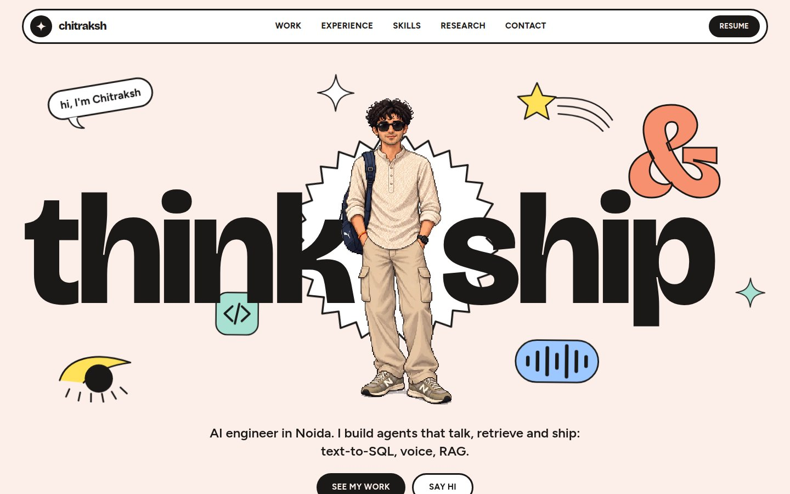

# Chitraksh Suri | Portfolio

Personal portfolio of Chitraksh Suri, an AI engineer who builds agents, RAG systems and voice AI.
A playful, pastel one-pager: giant type, a pixel-art avatar, outlined stickers and a cursor-reactive hero.



## What's on the page

| Section | What it shows |
| --- | --- |
| **Hero** | "think & ship" in huge type around a pixel-art avatar. The avatar and stickers move slightly in 3D with the cursor. |
| **About** | Who I am, what I'm doing now, and how I got here. |
| **Work** | AgentIQ (company case study) plus eight GitHub projects, newest first, each with live demo and code links. |
| **Experience** | Prismberry, The Ladder and Dreamable as a stack of sticky cards. |
| **Skills** | AI & ML, LLMs, AI frameworks, vector DBs, backend and tooling. |
| **Research** | IEEE SCEECS 2026 paper, linked to IEEE Xplore. |
| **Contact** | Email, LinkedIn, GitHub, Upwork and resume. |

## Tech stack

- **Next.js 16** (App Router) with **React 19** and **TypeScript**
- **Tailwind CSS v4** for styling, with design tokens in `src/app/globals.css`
- **Framer Motion** for reveals and the cursor parallax
- **next/font** with Bricolage Grotesque (display) and Figtree (body)
- No backend and no database: the whole site is static

## Getting started

Requires Node.js 20 or newer.

```bash
git clone git@github.com:ChitrakshSuri/portfolio.git
cd portfolio
npm install
npm run dev        # http://localhost:3000
```

Other scripts:

```bash
npm run build      # production build
npm run start      # serve the production build
npm run lint       # ESLint
```

## Editing the content

Everything you read on the page lives in one file: [`src/data/content.ts`](src/data/content.ts).

- `profile`: name, email, and the LinkedIn, GitHub, Upwork, resume and paper links
- `projects`: each project's title, date, blurb, tags, links and image. The list is sorted newest first automatically.
- `agentiq`, `jobs`: the company case study and work history
- `skills`, `marquee`: skill groups and the scrolling banner

To add a project, append an object to `rawProjects` with a `sort` date (`YYYY-MM-DD`). It lands in the right place on its own.
A project can use a screenshot (`image: "/img/your-shot.jpg"`) or one of the drawn illustrations (`art`), which are defined in `src/components/Doodles.tsx`.

## Project structure

```
src/
  app/
    layout.tsx        fonts, metadata, motion provider
    page.tsx          page order
    globals.css       colour tokens, buttons, hero layout, keyframes
    icon.png          favicon (cropped from the avatar)
  components/
    Hero, About, Work, Experience, Skills, Research, Contact, Nav, Marquee
    Doodles.tsx       the SVG stickers and project illustrations
    Reveal.tsx        scroll-in animation wrapper
  data/content.ts     all copy and links
public/img/           avatar and project screenshots
docs/preview.jpg      screenshot used in this README
```

## Design notes

- **Palette:** blush background, near-black ink, and flat coral, yellow, mint, sky, lilac and pink fills. Colours are CSS variables, so a retheme is a few lines.
- **Stickers:** 3px ink outlines and large radii on every card, button and doodle.
- **Motion:** transform and opacity only. The cursor parallax is capped at a few degrees and is off on touch devices. `prefers-reduced-motion` turns animations off and keeps all content visible.
- **Responsive:** the hero is recomposed on phones, with the words stacked above the avatar.
- **Accessibility:** one `h1`, visible focus rings, alt text on the avatar and screenshots, and decorative SVGs hidden from screen readers.

## Deploying

The site is static, so Vercel works well and never sleeps (unlike free Render web services, which spin down when idle).

1. Push this repo to GitHub.
2. In [Vercel](https://vercel.com), choose **Add New → Project** and import it. The Next.js defaults need no changes.
3. Under **Settings → Domains**, add your domain and copy the DNS records Vercel shows into your registrar's DNS panel.

## Credits

- Layout energy inspired by the WOW sparkling-water landing page.
- Pixel-art avatar of Chitraksh.
- Project screenshots are of my own live demos.

## Contact

[chitrakshsuri2005@gmail.com](mailto:chitrakshsuri2005@gmail.com) · [LinkedIn](https://www.linkedin.com/in/chitrakshsuri) · [GitHub](https://github.com/ChitrakshSuri) · [Upwork](https://www.upwork.com/freelancers/~015f55204594669b58)
